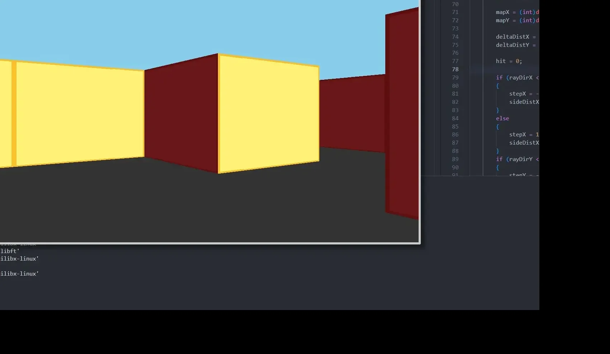

# Cub3D

*[English version](README.md)*

Un raycaster à la Wolfenstein 3D, en C avec la MiniLibX : murs texturés, déplacements au clavier et
collisions, à partir d'une carte en 2D. Projet de l'école 19 (réseau 42), réalisé en binôme (logins
`msochor` et `huburton`).



## Ce qu'il fait

- Il lit un fichier `.cub` : quatre textures de murs (`NO`, `SO`, `WE`, `EA`, au format `.xpm`), les
  couleurs du sol et du plafond, puis la carte, qui doit être fermée par des murs et contenir une seule
  position de départ (`N`, `S`, `E` ou `W`).
- Il lance un rayon toutes les deux colonnes (256 rayons pour une fenêtre de 512 pixels) sur un champ de
  vision de 60°, avec l'algorithme DDA, et corrige la distance pour éviter l'effet « fish-eye ».
- Il dessine chaque tranche de mur avec la bonne texture, échantillonnée en virgule fixe ; le sol et le
  plafond sont des aplats de couleur.
- Il déplace le joueur en temps réel, avec des collisions testées sur un rayon autour de lui.

```text
NO ./textures/north.xpm        111111
SO ./textures/south.xpm        1000N1
WE ./textures/west.xpm         100001
EA ./textures/east.xpm         111111
F 220,100,0
C 225,30,0
```

## Le raycaster, étape par étape

1. **Joueur** : une position en pixels, un angle en radians, des indicateurs de mouvement et un rayon de collision.
2. **Rayons (DDA)** : pour chaque rayon, un vecteur direction, un pas (±1), les distances delta et
   initiales, puis un parcours de la grille, case par case, jusqu'au premier mur.
3. **Projection** : `line_height = HEIGHT / perpendicular_distance`, centrée verticalement et limitée à l'écran.
4. **Texture** : le point d'impact sur le mur donne la colonne de texture ; les lignes sont lues le long de la tranche.

## Commandes et compilation

| Touche | Action |
|---|---|
| `W` `S` | avancer / reculer |
| `A` `D` | pas de côté à gauche / à droite |
| `←` `→` | tourner |

```bash
cd CUB3D && make
./cub3D maps/test.cub
```

## Ressources

- [Le tutoriel de raycasting de Lode](https://lodev.org/cgtutor/raycasting.html)
- [Une vidéo qui explique le raycasting](https://www.youtube.com/watch?v=g8p7nAbDz6Y)

L'IA nous a servi à mieux comprendre les maths du raycasting.
